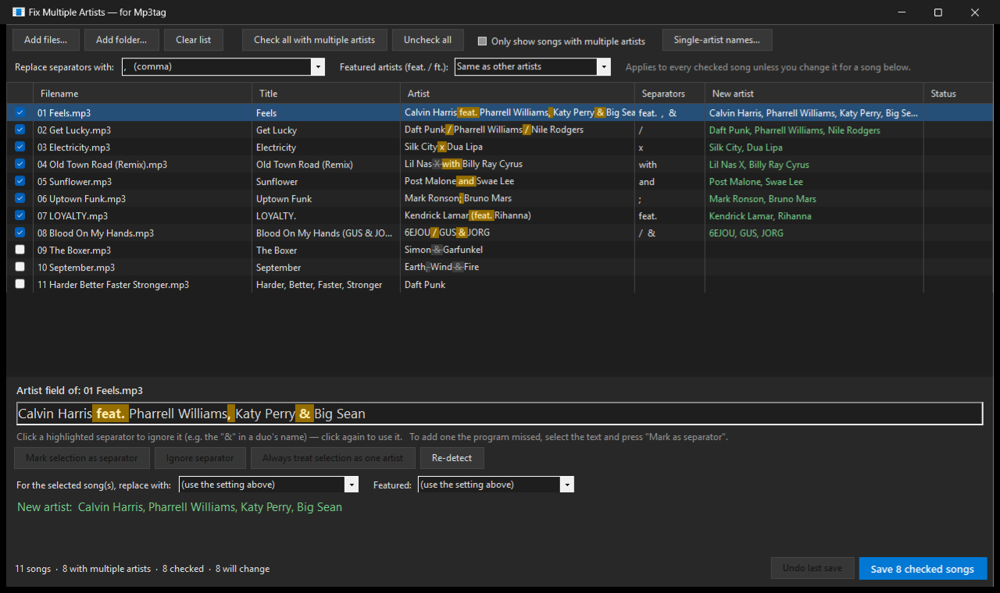
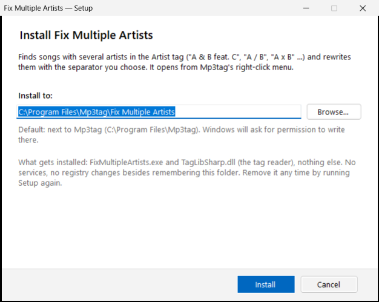
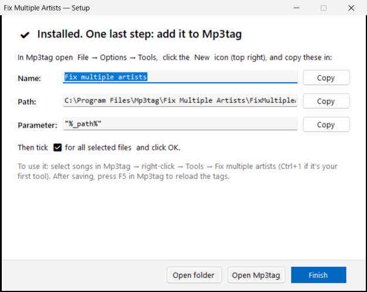

# Fix Multiple Artists for Mp3tag

Clean up the **Artist** tag on songs that list more than one artist, right from [Mp3tag](https://www.mp3tag.de/en/)'s right-click menu.

Songs from different sources write multiple artists in different ways:

```
Chief Keef & DJ KENN AON feat. Gino Marley
6nk / SMUEX / Thoomrsxoh
AK47 X SYQRA
Daedelus with Busdriver
Kendrick Lamar (feat. Rihanna)
```

This tool finds those songs, **highlights what separates the artists**, lets you correct anything it got wrong, and rewrites them all in the style **you** choose, for example `Artist, Artist feat. Artist`.



---

## Install (about one minute)

1. **Download** `FixMultipleArtists-Setup.exe` from the [latest release](../../releases/latest).
2. **Run it.** Windows may show *"Windows protected your PC"*, because the app isn't code-signed. Click **More info → Run anyway**.
3. **Choose where to install it.** The default is a folder next to Mp3tag (`C:\Program Files\Mp3tag\Fix Multiple Artists`). Click **Browse…** to pick anywhere else. Click **Install**. Windows asks for permission only if the folder needs it, which Program Files does.

   

4. **Add it to Mp3tag.** The last screen shows the three values to paste in, each with a **Copy** button:
   - In Mp3tag go to **File → Options → Tools** and click the **New** icon (top right).
   - Paste the **Name**, **Path** and **Parameter** (`"%_path%"`, with the quotes).
   - Tick **for all selected files** and click **OK**.

   

That's it. Requirements: Windows 10 or 11 (it uses the .NET Framework 4.8 built into Windows) and Mp3tag.

**Update:** run the newest Setup and click **Update**.
**Uninstall:** run Setup and click **Uninstall**, then delete the Tools entry in Mp3tag.

---

## How to use it

1. In Mp3tag, **save any unsaved changes** (Ctrl+S).
2. **Select songs**: an album, a few albums, or your whole library.
3. **Right-click → Tools → Fix multiple artists** (or **Ctrl+1** if it's your first tool).
4. In the window:

| You want to… | Do this |
|---|---|
| Pick the new separator for everything | **Replace separators with** (top). Choose `,` `;` `&` `/` `and` `x` `with` `feat.` …, **Separate values** (a real multi-value tag, shown as `\\` in Mp3tag) or **Keep as is**. You can also type your own. It's used exactly as typed, so include spaces, e.g. ` + `. |
| Handle *feat.* differently | **Featured artists**: *Keep as is*, change it to `feat.` / `ft.` / `featuring` / `(feat. …)`, or *Same as other artists*. |
| Choose which songs get changed | Only **checked** songs are saved. Songs with multiple artists start checked. Select rows with **Click / Shift+Click / Ctrl+Click**, then click any checkbox in the selection (or press **Space**) to check or uncheck them all. |
| See what will happen | The **New artist** column previews every change. Nothing is written until you click Save. |
| Fix a wrong separator, e.g. a duo name like "GUS **&** JORG" | Click the highlighted `&` in the bottom panel. It turns grey and crossed out (ignored). Click again to use it. |
| Add a separator it missed | Select the text in the bottom panel and click **Mark selection as separator**. |
| Never split a name again, e.g. "Simon & Garfunkel" | Select it and click **Always treat selection as one artist**. Manage the list with **Single-artist names…**. Common ones like *AC/DC*, *Earth, Wind & Fire*, *Tyler, The Creator* and *Lil Nas X* are already included. |
| Use a different separator for some songs | Select them, then use the two dropdowns in the bottom panel. They override the top setting for just those songs. |

5. Click **Save N checked songs**, confirm, then press **F5 in Mp3tag** to reload the tags.
   Changed your mind? **Undo last save** puts the old values back.

You can also run the program on its own and drag songs or folders onto it, or use **Add files…** / **Add folder…**.

---

## How it works

**Detection.** Each Artist tag is scanned (ignoring case) for these separators:

| Separator | Matches |
|---|---|
| `,` `;` `/` | with or without spaces |
| `&` `and` `x` `with` `vs.` | as separate words, so *Xavier*, *Andy* and *Alexander* are left alone |
| `feat.` `ft.` `featuring` `features` | also `(feat. …)` / `[ft. …]` |
| `\\` | Mp3tag's multi-value separator |

Separators inside a **single-artist name** from your list are shown greyed out and never split. Your manual changes (ignored or added separators) are kept per song.

**Rebuilding.** The tag is split into individual artists at the active separators. Then it's joined again with your chosen separator. If you choose a separate style for featured artists, everything after the first *feat.* is treated as the featured group:

```
Calvin Harris feat. Pharrell Williams, Katy Perry & Big Sean
  ","  +  feat. "Keep as is"      →  Calvin Harris feat. Pharrell Williams, Katy Perry, Big Sean
  " & " +  "(feat. …)"            →  Calvin Harris (feat. Pharrell Williams & Katy Perry & Big Sean)
  "; "  +  "Same as other artists" → Calvin Harris; Pharrell Williams; Katy Perry; Big Sean
```

**Writing.** Only the Artist field is changed, using [TagLib#](https://github.com/mono/taglib-sharp). Title, album, cover art, the audio itself and the ID3 version (v2.3/v2.4) are left untouched, and no new tag types (like ID3v1) are added. It works with MP3, FLAC, M4A/MP4, OGG, Opus, WMA, WAV, AIFF, APE, WavPack, Musepack and DSF.

**Mp3tag integration.** Mp3tag starts a tool once *per selected file*. The first copy opens the window. Every later copy passes its file to it through a named pipe and exits, so 500 selected songs still open one window.

Settings and your single-artist names are stored in `%APPDATA%\ArtistFixer`.

---

## Building from source

No SDK needed. The build uses the C# compiler that ships with Windows.

```powershell
powershell -ExecutionPolicy Bypass -File build.ps1 -test
bin\EngineTests.exe
```

This produces `bin\FixMultipleArtists.exe`, `bin\FixMultipleArtists-Setup.exe` (which carries the app inside it) and the test runner.

```
src/         the app (detection engine, tag reading/writing, window)
installer/   the one-file Setup
tests/       engine and tag round-trip tests
lib/         TagLibSharp.dll 2.3.0 (LGPL-2.1, https://github.com/mono/taglib-sharp)
```

## License

[MIT](LICENSE). The bundled `lib/TagLibSharp.dll` is a separate library under its own license, [LGPL-2.1](https://github.com/mono/taglib-sharp/blob/main/COPYING).

Mp3tag is freeware by Florian Heidenreich. This is an independent companion tool and is not affiliated with Mp3tag.
